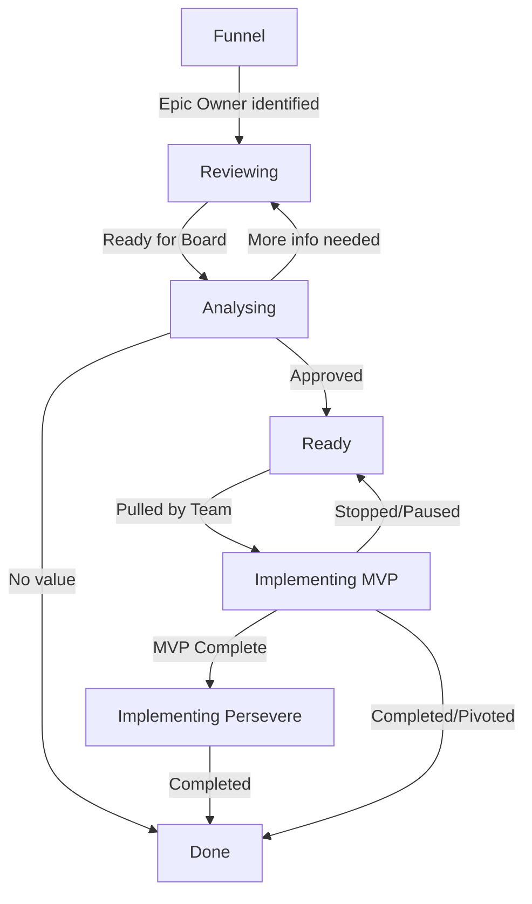

# Epic Kanban System States

This document gives a visual example of what how Epics can moves between states for an Epic Kanban System. It is based on the Epic Kanban System used for with the Mantid software within the ISIS Neutron and Muon research facility, showing a subset of its flow transitions.

## State Overview Table

| Funnel | Reviewing | Analysing | Ready | Implementing MVP | Implementing Persevere | Done |
| :--- | :--- | :--- | :--- | :--- | :--- | :--- |
|      |      |      |      |      |      |      |

## Workflow Diagram

## State Definitions

### 1. Funnel
**Purpose:** Entry point for big needs and ideas.

> **Note:** Sometimes it is unclear whether an area of concern has any software requirements and indeed if any of these are large enough to be Epic Kanban System concerns. For such cases within we recommend starting with a blank page to investigate and discuss (in many cases at ISIS/STFC we  within the ISIS/STFC Jira eco-system created **Explore** items that started there life in Funnel and were move straight to Done once exploration was done - which in some cases identified no new software needs and in other cases some Epics and/or smaller code features were needed).
>
> For example, if a new instrument is planned but there has been no discussion of its software needs.

### 2. Reviewing
**Purpose:** Refinement with or lead by the Epic owner.

An Epic moves from Funnel to Reviewing once an Epic Owner with capacity has been identified. In this state, the Epic Owner with others refines the Epic, clarifies scope, provide initial resource estimate and prepares it for wider review.

### 3. Analysing
**Purpose:** Ready for wider consumption and ISIS-STFC Mantid Programme Board prioritisation.

An Epic moves into Analysing when it is sufficiently well-formed for consideration by the Board. Before moving an Epic into this state, the default with Mantid at ISIS-STFC was to include a check, as of 2025: Product Manager checks with the Epic Owner and seeks agreement from the ISIS-STFC Mantid Team Lead. The details of how this check is done is of less importance - the key is that, when an Epic is moved from Reviewing to Analysing it is assumed comprehensible enough for wider consumption and assessment.

**Board Decisions:**

* **Move back to Reviewing:** If the Epic lacks clarity or key information.
* **Move to Ready:** If the Epic is deemed sufficiently valuable and well-understood.
* **Move to Done:** If the Epic is judged to have insufficient value.
* **Conditional Review:** The Board may request specific follow-up work. If this work is completed and no objections are raised within one week (via email), the Epic may move to Ready.

### 4. Ready
**Purpose:** Maintain Prioritised list of approved Epics.

The Ready state contains Epics that have been approved by the Board.

Once all Epics in Analysing have been cleared, the Epics that reach Ready are candidates for prioritisation. In practice, prioritisation is deferred until after Epics in Implementing have been discussed. Relative prioritisation is then performed across Epics in both Ready and Implementing.

An Epic in Ready may be moved to Done if it becomes irrelevant, for example if an instrument upgrade is cancelled and the associated software work is no longer required.

> **Note:** With Mantid as of 2025 we didn't observe a need for separating the Epics prioritisation, e.g. into one prioritisation for business Epics and one for enabler Epics.

### 5. Implementing MVP
**Purpose:** Delivery of the Minimum Viable Product (MVP).

An Epic moves into Implementing MVP once it is pulled by the development Team.

**Team and Epic Owner Guidance:**
* Small deviations from the original Epic goals are acceptable.
* Radical changes require stopping work and creating a new Epic in Funnel.
* By agreement between the Epic Owner, Lead Developer, and Team Lead, the Epic may move to Implementing Persevere or be stopped.

**Board Process:**
* Discuss Epics in this state, including presentations or demos where relevant.
* **Move back to Ready:** If work is stopped and likely to remain so until at least the next prioritisation event, provided the Epic is still deemed sufficiently valuable.
* **Move to Done:** If it is sufficiently completed or pivoted.

### 6. Implementing Persevere
**Purpose:** Continue beyond MVP toward full delivery.

An Epic moves from Implementing MVP to Implementing Persevere when the MVP is sufficiently complete and the outcomes justify continuing with the full planned feature set.

The Board reviews Epics moved to Persevere between and during prioritisation events. If significant MVP features are found to be incomplete, the Epic may be moved back to Implementing MVP, assuming it is still deemed sufficiently valuable.

### 7. Done
**Purpose:** Completion or closure.

An Epic moves to Done when it is sufficiently completed, pivoted, or no longer a concern.

> **Note:** Epics in this state are periodically archived.
